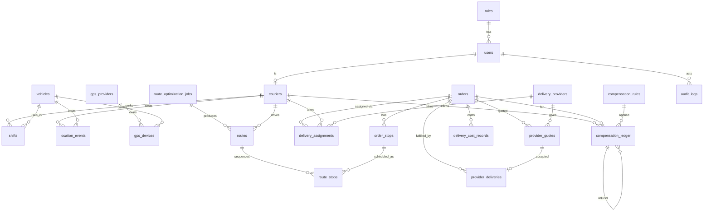

# ERD (Mermaid)

Standalone: `weather_observations`, `weather_forecasts`, `integration_credentials`, `integration_events`.
Authoritative definitions: `backend/app/models/__init__.py` and Alembic migrations.
